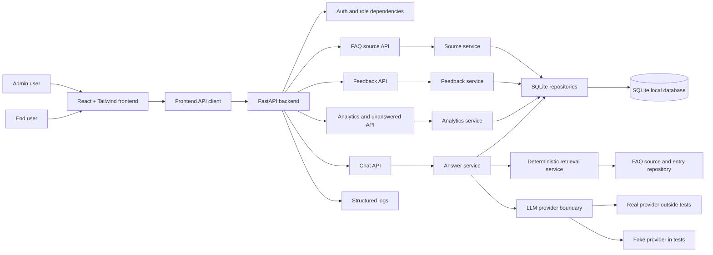
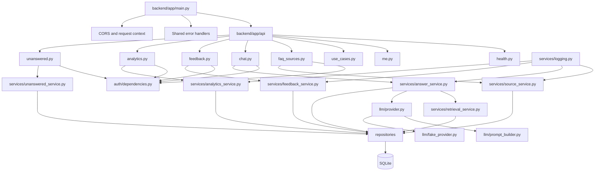
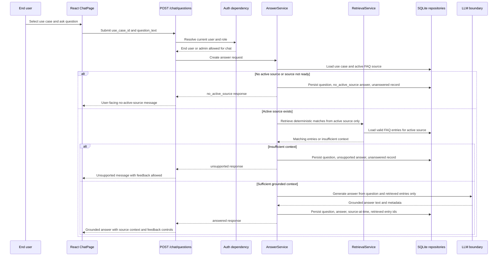
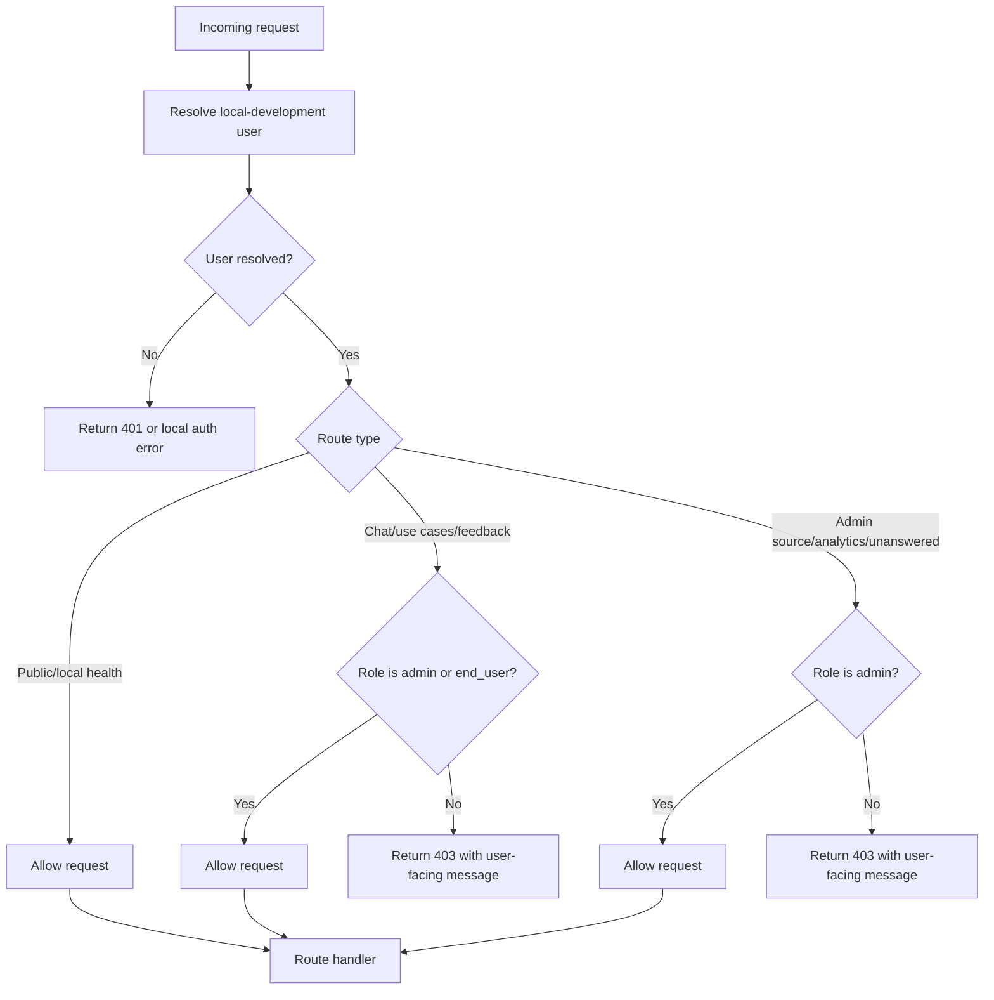
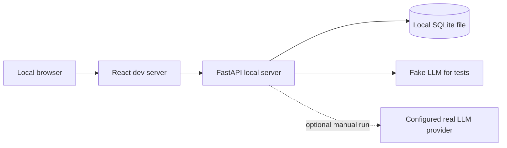

# Architecture: Configurable FAQ Knowledge Assistant

## Source

This architecture document is based on `specs/001-faq-knowledge-assistant/plan.md`.

Note: `specs/faq-assistant/plan.md` is not present in this workspace; the active Spec Kit plan is `specs/001-faq-knowledge-assistant/plan.md`.

## System Architecture



## Backend Module Diagram



## Request Flow for Grounded Chat



Grounding rules:

- The selected use case determines the only eligible FAQ source.
- Retrieval must run before LLM generation.
- Inactive, archived, invalid, and different-use-case sources are excluded.
- If retrieval cannot supply sufficient context, the backend returns an unsupported answer and does not call the LLM boundary.
- Tests must use `llm/fake_provider.py` or equivalent fake provider, never a real LLM API.

## Data Ownership Boundaries

### Frontend Owns

- Current route and local UI state
- Form input before submission
- Loading, empty, error, and selected-filter display state
- User-facing layout behavior for admin and end-user screens
- API response adaptation for components

The frontend does not own authorization decisions, answer grounding, source activation rules, analytics truth, or persistence.

### Backend API Owns

- Request validation and response shape
- Role enforcement for admin-only routes
- Error response codes and safe display messages
- Routing to services
- Request-scoped logging and error handling

### Domain Services Own

- FAQ source lifecycle rules
- Single-active-source-per-use-case behavior
- Readiness validation for FAQ sources
- Deterministic retrieval and unsupported-answer decisions
- Answer orchestration
- Feedback association rules
- Analytics aggregation rules

### Repositories Own

- SQLite persistence access
- Transaction boundaries
- Query helpers for source lists, active source lookup, questions, answers, feedback, analytics, and unanswered questions

Repositories should not decide whether an answer is grounded or whether a user is authorized; those decisions live in services and auth dependencies.

### SQLite Owns

- Durable local-development records for users, use cases, FAQ sources, FAQ entries, conversations, questions, answers, feedback, unanswered questions, and event/audit-like source history

### LLM Boundary Owns

- Provider interface
- Prompt construction from already-retrieved active-source context
- Fake provider behavior for tests
- Response normalization back to the answer service

The LLM boundary does not select FAQ sources, search across sources, enforce roles, or persist answers.

## LLM Integration Boundary

The LLM integration is intentionally isolated behind `backend/app/llm/`.

Expected boundary inputs:

- `question_text`
- `use_case_id` and use case label
- Active `faq_source_id` and source metadata
- Retrieved FAQ entries selected by deterministic retrieval

Expected boundary outputs:

- Candidate answer text
- Grounding metadata
- Provider status or refusal signal

Boundary constraints:

- No route handler calls a real LLM provider directly.
- The answer service calls the LLM only after deterministic retrieval succeeds.
- Automated tests bind a fake provider and assert no real external LLM API is called.
- LLM output is treated as untrusted until the answer service validates state and grounding metadata.

Future vector search can be added before this boundary, but the first implementation uses deterministic lexical retrieval only.

## Auth and Role-Based Access Flow



Access rules:

- Admin-only: FAQ source management, activation/deactivation/archive/delete, analytics, unanswered question review.
- End-user allowed: use case listing, chat questions, feedback submission.
- Admins may use chat, but chat uses the same active-source grounding rules as end users.
- Frontend navigation may hide admin areas, but backend authorization is the source of truth.

## Observability Points

Structured logging should be added at these points:

- Request received with route, method, user role, and request/correlation id
- Authorization failure with route, role, and denial reason
- FAQ source created, updated, activated, deactivated, archived, deleted
- Source readiness validation result
- Chat question submitted with use case and source-at-time ids
- Retrieval result with matched entry count and unsupported reason, without logging unnecessary full answer content
- LLM boundary called, skipped, failed, or fake provider used
- Answer persisted with answer state
- Feedback submitted with rating and answer id
- Analytics requested with use case, source, and time filters
- Unanswered question listed or reviewed
- Validation and service errors mapped to user-facing error responses

Initial metrics are derived from stored records:

- Question count
- Answered count
- Unanswered count
- Helpful feedback count
- Unhelpful feedback count
- Unanswered questions by use case/source/time period

## Deployment Assumptions for Local Assessment Environment

The first implementation targets a local assessment environment, not production deployment.

Assumptions:

- Backend runs locally with Python 3.11+ using FastAPI.
- Frontend runs locally with React + Tailwind CSS development tooling.
- SQLite is used for local persistence.
- Local-development role selection or simple local user resolution is sufficient for assessment.
- Real LLM credentials are not required for automated tests.
- Automated tests use the fake LLM provider.
- The assessment environment can run backend tests with `pytest`.
- The assessment environment can run frontend build/tests with npm scripts once dependencies are installed.
- No production identity provider, distributed tracing backend, managed database, object storage, or vector index is required for the initial assessment.

Expected local commands:

```bash
cd backend && pytest
cd backend && pytest --cov=app --cov-report=term-missing
cd frontend && npm run build
cd frontend && npm run test
```

Local runtime shape:



Manual real-provider use, if enabled later, must remain outside automated tests and must still respect deterministic retrieval-first grounding.
